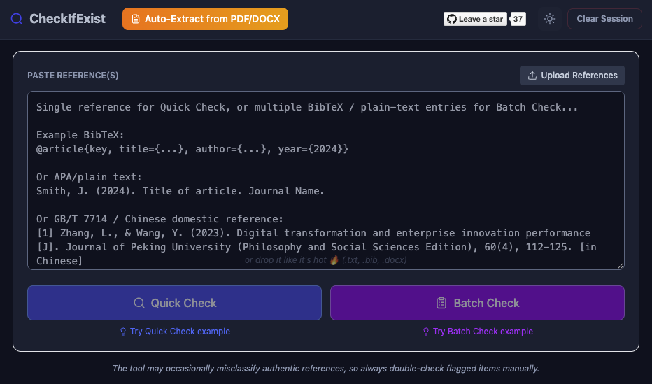

---
aliases:
  - 14_reference_and_citation_methods.html
---

# Reference and citation methods [✎ Draft]{.badge .badge-draft2} {#sec-reference-citation}

```{r}
#| include: false
if(file.exists("../_setup.R")){source("../_setup.R")}
```

An article's reference list is part of its evidence. Each citation is a claim that another document exists, and that it says what the citing article says it says. Both claims can be checked. This chapter covers three ways they can fail: 

- the cited document does not exist
- the cited document has been retracted
- the cited document does not support the claim it is cited for

The first two problems can now be screened for semi-automatically. The third still mostly requires carefully reading and checking the cited articles. 

## Nonexistent and hallucinated references {#sec-hallucinated-references}

A nonexistent reference points to an article that does not exist. Some are fabricated outright and bear no relationship to any published article. Others may bear some resemblance to a published article, e.g., sharing a similar name or authorship but with other details incorrect - often the DOI resolves to a totally unrelated article. Many of these come from large language models. Others are real articles cited with the wrong title, authors, year, or DOI, so that the reference cannot be traced to the document it is supposed to point to.

These references are already common in the published literature and becoming more so. @topaz2026 checked around 2.5 million articles in PubMed Central and found 4,046 fabricated citations in 2,810 of them.

::: big-number
[1 in 277]{.number}

[biomedical articles published in early 2026 contained a fabricated reference, up from 1 in 2,828 in 2023 [@topaz2026].]{.description}
:::

@zhao2026 found the same trend across arXiv, bioRxiv, SSRN, and PubMed Central. The rate of references that could not be matched to any published work rose sharply from mid-2024, and the authors estimated rates of hallucinated citations in 2025 of 0.27% for PubMed Central and 1.91% for SSRN. Neither study can show that any one fabricated reference was produced by a language model; paper mills and deliberate manipulation produce them too. Either way, they passed whatever editorial checks the articles went through.

A single nonexistent reference is not by itself evidence that an article's results are untrustworthy. It does show that at least part of the text was not checked by its authors, and it raises questions about how the rest of the article was produced. Several nonexistent references, especially ones cited for key claims, are a more serious concern.

::: {.callout-note title="Example: a reference whose DOI leads to an unrelated article"}
@baldeo2026 reported that heavy use of generative AI was associated with lower confidence in one's own reasoning. It was promoted in a [press release by the American Psychological Association](https://www.apa.org/news/press/releases/2026/04/overreliance-ai-undermine-confidence), the journal's publisher, titled "Overreliance on AI programs may undermine confidence at work". It was then covered by [*Time*](https://time.com/article/2026/04/15/how-ai-use-affects-confidence-thinking-study/) ("Letting AI do your work erodes your confidence, according to a new study") and [*Futurism*](https://futurism.com/health-medicine/ai-cognition-study) ("Study finds AI use eats away at users' confidence in their own brains").

Its reference list contained only nine references. Commenters on [PubPeer](https://pubpeer.com/publications/E3065B6D2261CDAD0F7F407003E027) - including myself, Sandra Grinchgl, Malte Elson, and Jamie Cummins - found that one of them, attributed to Clemenson, Stark, and Stark (2021) in the *Journal of Experimental Psychology: General*, could not be found anywhere. Its DOI led to a different article: Tompary and Thompson-Schill's (2021) "Semantic influences on episodic memory distortions". Two other references were real, but were cited for claims about cognitive offloading that they did not make, one of the problems covered in @sec-miscitation.

The commenters also raised many other concerns, including regression results that were mathematically impossible given the reported correlations (see @sec-recalculation), implausible recruitment, and measures that did not match the article's claims. The journal [opened an investigation](https://retractionwatch.com/2026/06/16/technology-mind-behavior-apa-journal-investigation-cognitive-impact-generative-ai/) and retracted the article in August 2026 [@baldeo2026retraction]. As [Retraction Watch reported](https://retractionwatch.com/2026/09/14/american-psychological-association-technology-mind-behavior-sarah-baldeo-id-quotient/), the company that granted ethical approval for the study was a company founded and run by the author, meaning that the study had not actually received independent ethical review. The APA's press release now carries a retraction notice; the *Time* and *Futurism* articles do not.
:::

### Automated tools

Checking whether a reference exists is tedious by hand, but simple to automate: extract each reference, search for it in bibliographic databases such as Crossref, OpenAlex, Semantic Scholar, and PubMed, and flag references with no close match. Many open-source tools now do this. They differ in three ways that matter to most readers:

- **Ease of use.** Some run in the browser and need no installation (e.g., [CheckIfExist](https://zabbonat.github.io/References-Validation/), CiteScan, and CiteAudit). Others must be installed locally and run from the command line or a local web interface (e.g., [Hallucinator](https://github.com/gianlucasb/hallucinator), [RefChecker](https://github.com/markrussinovich/refchecker), and [HalRef](https://github.com/davidjurgens/hallucinated-reference-finder)).
- **Cost.** Most are free. Some features depend on paid services; for example, RefChecker's hallucination check needs access to a language model with web search.
- **Validation.** Few have been tested independently, and several are tuned to the reference formats and databases of computer science, which makes them less suitable for psychology and medicine.

@badalova2026 compared five of these tools on 104 references from three documents, which they had checked by hand: 71 genuine references and 33 problematic ones, such as references with incorrect titles, mismatched authors or journals, unresolvable or incorrect DOIs, or no traceable source.

| Tool | Problematic references caught | Genuine references accepted | Sensitivity | Specificity |
|---|---|---|---|---|
| RefChecker | 32 of 33 | 35 of 71 | .97 | .49 |
| CheckIfExist | 31 of 33 | 37 of 71 | .94 | .52 |
| Hallucinator | 29 of 33 | 43 of 71 | .88 | .61 |
| HalRef | 24 of 33 | 18 of 71 | .73 | .25 |
| HalluCiteChecker | 18 of 33 | 51 of 71 | .55 | .72 |

: Performance of five tools for detecting nonexistent and problematic references. Counts from @badalova2026 [Table 4]; sensitivity and specificity calculated from them. {#tbl-reference-checkers}

@tbl-reference-checkers shows a trade-off between sensitivity (the proportion of problematic references a tool flags) and specificity (the proportion of genuine references it accepts). A tool can catch more problematic references by being stricter about what counts as a match, but the same strictness makes it flag more genuine references whose details are slightly off. The tools that caught the most problematic references also flagged around half of the genuine references, and the tool with the fewest false alarms missed almost half of the problematic references. No tool did well on both. The main causes of false alarms were errors in extracting references from PDFs, sensitivity to formatting, and gaps in database coverage (e.g., books, reports, and very recent or non-English work). The test set is also small. These tools are therefore screening tools: every flagged reference has to be checked by hand, by searching for its title and DOI, before anything is said about it.

For now, I recommend [CheckIfExist](https://zabbonat.github.io/References-Validation/) [@abbonato2026]. It caught 31 of the 33 problematic references in @badalova2026's comparison, it is free, and it runs as a web app with no login. It accepts a full PDF or Word document, a BibTeX file, or pasted references, and checks them against Crossref, Semantic Scholar, and OpenAlex. These are general-purpose databases, so it is a reasonable fit for psychology and medicine.

::: big-quote
[[CheckIfExist](https://zabbonat.github.io/References-Validation/)]{.quote}

[Free web app, no login required: zabbonat.github.io/References-Validation]{.citation}
:::

{#fig-checkifexist fig-alt="Screenshot of the CheckIfExist web app, showing a text box for pasting references in BibTeX or APA format, buttons to upload references or auto-extract them from a PDF or Word file, and Quick Check and Batch Check buttons."}

CheckIfExist's sensitivity is good, but its specificity is not: it also flagged 34 of the 71 genuine references. So in @badalova2026's comparison, about half of the references it flagged were in fact fine. In a typical article the proportion will be worse, because most reference lists contain few or no problematic references, so most of the flags will be false alarms. A flag from CheckIfExist means only that a reference needs checking, not that it is nonexistent. Check each flagged reference by hand before drawing any conclusions about it.

## Citations of articles that exist but do not support the claim {#sec-miscitation}

The most common citation problem cannot be caught by checking that a reference exists. A real, unretracted article can still be cited for something it does not say. In medicine this is often called "quotation accuracy"; @cobb2023 call it "miscitation".

To the best of my knowledge, it is currently quite rare for such inaccuracies or miscitations to be the basis of a retraction. It is unclear whether this is due to journals/publishers not viewing this as a serious problem, or whether reports to research integrity offices do not tend to references such issues. Nonetheless, a high prevalence of miscitation of the literature may undermine an article's trustworthiness.

## Estimates from psychology

@cobb2023 checked 3,347 citations of empirical studies in the introductions of 89 articles, from the most recent issues of eight leading psychology journals. Two independent coders compared each citing claim to the methods and results of the cited article. Each citation was coded as accurate, somewhat accurate (correct in broad terms, but omitting an important qualifier, e.g., describing an effect found only in boys as an effect in children), or inaccurate (the claim was never examined in the cited article, or the cited article found the opposite). When coders could not agree, the citation was given the more lenient code.

::: big-number
[19%]{.number}

[of 3,347 citations in 89 articles in eight leading psychology journals were only 'somewhat accuate', e.g., failed to include important nuance of the article they cited [@cobb2023].]{.description}
:::

::: big-number
[10%]{.number}

[of citations completely mischaracterized the results of the article cited, e.g., the cited article did not examine the claim or found the opposite [@cobb2023].]{.description}
:::

Of the 318 inaccurate citations, 195 cited an article for something it never assessed, and 123 cited an article for a result it contradicted. Rates varied between journals. The *Journal of Consulting and Clinical Psychology* had the most miscitations, at 28.7%, which is more than one in four. Miscitation was not related to the number of authors or the seniority of the first author.

These are probably underestimates for the literature as a whole. The journals were among the most prestigious in their fields, and disagreements between coders were resolved in the authors' favour.

### Estimates from medicine

Miscitation has been studied for longer in medicine, where it is usually called a "quotation error". @jergas2015 meta-analysed 28 studies of quotation accuracy in medical journal articles.

::: big-number
[25%]{.number}

[(95% CI [19.5, 32.4]) of citations in medical journal articles contain a quotation error [@jergas2015].]{.description}
:::

::: big-number
[12%]{.number}

[(95% CI [8.4, 16.6]) of citations contain a major quotation error [@jergas2015].]{.description}
:::

Heterogeneity between studies was substantial, but even the lowest estimate was 6.7%. Citations of secondary rather than original sources accounted for less than one sixth of the errors. @mogull2017 reanalysed 15 such studies, counting errors per citing statement rather than per reference, and estimated a lower overall rate of 14.5% (95% CI [10.5, 18.6]). About two thirds of these errors (64.8%) were major: the cited source did not support the claim, was unrelated to it, or contradicted it.

Individual studies show the same pattern in specific fields:

- In 250 randomly selected citations from the five highest-impact orthopaedic and sports medicine journals, 13.6% were not fully supported by the cited article, and 2.8% were completely unsupported [@gazendam2021].
- In 2,995 articles citing 13 highly cited nephrology papers, 15% contained at least one inaccurate citation of those papers. The most common problem was citing a finding the cited article did not report (38.4% of inaccurate citations), and one fifth of the inaccurate citations repeated an earlier inaccurate citation rather than the original article [@pavlovic2021].
- A 2010 commentary criticising the Newcastle-Ottawa scale, a tool widely used to rate the quality of observational studies in systematic reviews, had been cited more than 1,250 times by 2016. In a random sample of 100 articles citing it, 96 were systematic reviews, and 94 of these (98%) cited it as support for using the scale: the opposite of what it argued [@stang2018].

The last example shows how miscitation spreads. Once a few authors cite an article for the wrong conclusion, later authors copy the citation without reading the original.

### Checking citations by hand

No validated automated tool yet checks whether a cited article supports a claim, so this check still means reading. It is not feasible to check every citation in an article, so focus on the citations that matter most:

- citations that support the study's rationale and hypotheses;
- citations given as justification for methods, such as measures described as "validated" or analyses described as "standard";
- citations used to interpret the results, especially claims that the results agree with previous research.

For each one, find the cited article and read its methods and results, not just its abstract. Check that the cited study examined the claim, in the population the citing article describes, and found what the citing article says it found. Citations of reviews and meta-analyses need particular care, because they are often cited as evidence for a general effect that the review itself found to vary or to be absent in some studies.

A few miscitations are, unfortunately, normal. They are a concern for trustworthiness when they are concentrated in the claims an article depends on, or when they all point the same way: towards making the article's own hypotheses look better supported than the cited literature suggests.

## Citations of retracted articles {#sec-retracted-citations}

Checking whether references have been retracted is a separate check from checking whether they exist. A retracted reference does exist, but it has been withdrawn from the record, often because its results could not be trusted. Citations of retracted work matter for two reasons.

First, an article that builds its rationale, methods, or interpretation on retracted work may inherit that work's problems.

Second, several citations of retracted work are a warning sign that the citing article came from a paper mill.

Paper mills are businesses that sell research articles, and authorship on them, to researchers who need publications, for example to be promoted or to graduate. They produce manuscripts to order, often from templates, with fabricated or recycled data and images. They then get them into journals, in some cases by bribing editors or by arranging entire special issues. They operate at an industrial scale, and their output appears to be growing faster than the legitimate literature. For accessible introductions, see:

- [The fight against fake-paper factories that churn out sham science](https://www.nature.com/articles/d41586-021-00733-5) (Holly Else and Richard Van Noorden, *Nature*, 2021);
- [Paper mills are bribing editors at scholarly journals, Science investigation finds](https://www.science.org/content/article/paper-mills-bribing-editors-scholarly-journals-science-investigation-finds) (Frederik Joelving, *Science*, 2024);
- [Scientific fraud has become an 'industry,' alarming analysis finds](https://www.science.org/content/article/scientific-fraud-has-become-industry-alarming-analysis-finds) (*Science*, 2025).

Paper mills tend to cite their own earlier products, to pad out reference lists and to raise the mill's citation counts. Once a mill is discovered, its products are often retracted in large batches. Articles from the same mill then have reference lists full of retracted articles. A reference list with several retracted articles is a flag in its own right, especially when they come from the same journal, special issue, or group of authors. It suggests the article may share their origin, whatever its own results look like.

### Feet of Clay

Guillaume Cabanac's [Problematic Paper Screener](https://dbrech.irit.fr/pls/apex/f?p=9999:33::::::) [@cabanac2022] includes a "Feet of Clay" detector [@cabanacfeetofclay], named after the Biblical image of a statue on a fragile base. It flags published articles that cite retracted articles, or articles flagged on PubPeer. It uses the retraction notices registered with Crossref, which now include the Retraction Watch Database. Each flagged article gets a report listing its problematic references, and you can also look up which articles cite a given retracted article. It covers the literature indexed by Dimensions, and its lists are updated periodically rather than in real time.

To check a single article's references yourself, you can also enter each cited DOI into the post-publication notice checker in @sec-post-publication-notice-checker. Reference managers such as Zotero also flag retracted items in your library, which helps authors avoid the problem in the first place.

### Interpreting citations of retracted articles

Citing a retracted article is not always a problem. The citation may predate the retraction, the article may be cited precisely because it was retracted, or it may be cited for a minor point. What matters is how many retracted articles are cited, what they are cited for, whether they were cited after the retraction notice, and whether they cluster in a way that suggests a common source. An article whose main hypothesis or method depends on a retracted study is a concern. So is one with many retracted references from the same journal or authors. An article that cites a single retracted study in passing, among a dozen others, usually is not.

